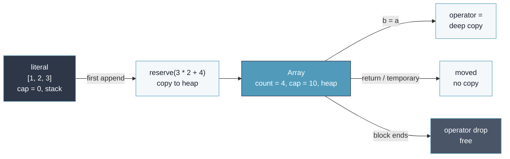
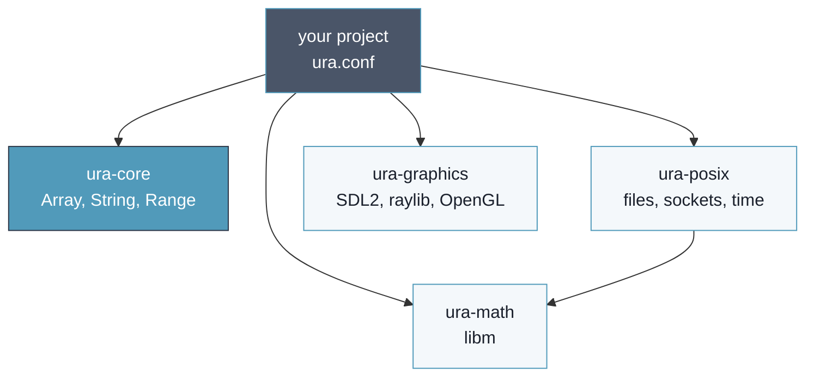

<p align="center">
  
</p>

<h1 align="center">ura-core</h1>

<p align="center">
  The core of <a href="https://github.com/mohammedhrima/ura-lang">ura</a>: growable arrays, strings, ranges, errors and the command line.<br>
  Loaded by itself in every program that depends on it.
</p>

<p align="center">
  
  
  
  
</p>

---

## At a glance

```ura
struct Player:
    name String
    score i32

    operator =(other &Player):
        self.name = other.name
        self.score = other.score

fn main() i32:
    names Array<String> = ["ada", "grace", "linus", "ken"]
    players Array<Player>
    for name in names:
        p Player
        p.name = name
        p.score = name.size() * 25
        players.append(p)

    best Player = players.first()
    for p in players:
        if p.score > best.score:
            best = p
        output(p.name.upper(), " ", p.score, "\n")

    title String = String::create("winner: ") + best.name
    output(title, " (", title.size(), " chars)\n")
    output("reversed: ", best.name.reverse(), "\n")
    return 0
```

<table>
<tr><th>Output of <code>ura run</code></th><th>What it shows</th></tr>
<tr>
<td>

```
ADA 75
GRACE 125
LINUS 125
KEN 75
winner: grace (13 chars)
reversed: ecarg
```

</td>
<td>

- an array literal becomes an `Array<String>`
- `for x in array:` walks any collection
- `operator =` decides how a struct is copied
- `+` joins strings, `upper` and `reverse` return new ones
- everything is freed at the end of `main`, no `free` call

</td>
</tr>
</table>

## Install

```
ura install ura-core 0.1.0 https://github.com/mohammedhrima/ura-core
```

This adds one line to your project's `ura.conf`. There's nothing to `use`: the core is loaded by itself.

```ura
@dependency "ura-core" "0.1.0" "https://github.com/mohammedhrima/ura-core"
```

## API quick reference

| Module | Import | Key types and functions | Notes |
|---|---|---|---|
| array | automatic | `Array<T>`, `append`, `insert`, `pop`, `first`, `last`, `size`, `reverse`, `[i]` | grows by `count * 2 + 4` |
| string | automatic | `String`, `String::create`, `+`, `upper`, `trim`, `find`, `replace`, `substr` | `struct String from Array<char>` |
| range | automatic | `Range::create(start, stop[, step])` | counts down when `stop < start` |
| error | automatic | `Error::create(message)`, `throw`, `try` / `catch` | uncaught errors exit with code 1 |
| os | automatic | `os.argc`, `os.argv` | `argv` is an `Array<String>` |
| memory | automatic | `new<T>(count)`, `copy<T>`, `free<T>` | what `Array` is built on |

<details>
<summary><b>Array&lt;T&gt;</b>: every method</summary>

| Method | Returns | Does |
|---|---|---|
| `append(value T)` | | adds at the end, growing when full |
| `insert(index i32, value T)` | | shifts the rest one place right |
| `pop()` / `pop(index i32)` | `T` | removes and returns the last / the one at `index` |
| `at(index i32)` | `T` | a copy, or a zeroed `T` when out of range |
| `first()` / `last()` | `&T` | a reference to the first / last element |
| `[index]` | `&T` | a reference, to read or write |
| `size()` / `len()` | `i32` | number of elements |
| `capacity()` | `i32` | slots allocated |
| `is_empty()` | `bool` | `size() == 0` |
| `reverse()` | | in place |
| `reserve(cap i32)` | | allocates at least `cap` slots |
| `resize(size i32)` | | grows or shrinks, dropping removed elements |
| `clear()` | | drops every element, keeps the memory |
| `release()` | | drops every element and frees the memory |
| `for x in array:` | | `operator in` gives each element |

</details>

<details>
<summary><b>String</b>: every method</summary>

| Method | Returns | Does |
|---|---|---|
| `String::create(text char[])` | `String` | from a C string |
| `String::create(number i32)` | `String` | the number's digits |
| `+ text` / `+ other` | `String` | a new joined string |
| `+= text` / `+= other` | | appends in place |
| `==` `!=` `<` `>` | `bool` | compares with a String or a C string |
| `compare(other &String)` | `i32` | `<0`, `0` or `>0` |
| `find(text)` | `i32` | first index, or `-1` |
| `contains(text)` / `starts_with(text)` / `ends_with(text)` | `bool` | |
| `substr(start i32, length i32)` | `String` | a slice |
| `upper()` / `lower()` | `String` | |
| `trim()` | `String` | without spaces, tabs and newlines at both ends |
| `replace(old, fresh)` | `String` | every occurrence |
| `repeat(times i32)` | `String` | |
| `reverse()` | `String` | |
| `to_int()` | `i32` | `"-42"` gives `-42` |
| `chars()` | `char[]` | a C string, for C functions |
| `String::length_of(text char[])` | `i32` | length of a C string |

Every `Array<char>` method works on a `String` too.

</details>

<details>
<summary><b>Range, Error, Os, memory</b></summary>

| Symbol | Does |
|---|---|
| `Range::create(start, stop)` | `start, start+1, ... stop-1`, or downwards when `stop < start` |
| `Range::create(start, stop, step)` | with any step |
| `Error::create(message String)` | an error to `throw` |
| `uncaught(error &Error)` | prints an error nobody caught; `main` then exits with 1 |
| `os.argc` / `os.argv` | the command line, as `i32` and `Array<String>` |
| `new<T>(count)` | `count` zeroed `T`s on the heap |
| `copy<T>(dst, src, count)` | copies `count` elements |
| `free<T>(data)` | frees what `new` gave |

</details>

## Memory layout

```
Array<T>                                   String  (struct String from Array<char>)
┌──────────────┐                           ┌──────────────┐
│ data   T[]  ─┼──► [ t0 | t1 | t2 | · · ] │ data  char[]─┼──► [ g | r | a | c | e | · · ]
│ count  i32   │     used: count           │ count i32  5 │
│ cap    i32   │     allocated: cap        │ cap   i32 12 │
└──────────────┘                           └──────────────┘
                                             same fields and methods as Array<char>,
                                             plus the text methods above
```

- **A literal borrows, a write owns.** `[1, 2, 3]` points at memory on the stack, with `cap` 0. The first change copies it to the heap: `append` through `reserve`, `[i]`, `pop` and `reverse` through `own()`.
- **Values own, references borrow.** `b = a` copies through `operator =`. A temporary, like the result of `+`, is moved instead of copied.
- **Drop at the end of the block.** Every `Array` and `String` is freed when its block ends, in reverse order.



## The ura standard library



| Repo | Version | What | Depends on |
|---|---|---|---|
| **ura-core** | 0.1.0 | Array, String, Range, Error, Os | nothing |
| [ura-posix](https://github.com/mohammedhrima/ura-posix) | 0.1.0 | the C library and the OS | ura-math |
| [ura-math](https://github.com/mohammedhrima/ura-math) | 0.1.0 | C's math library | nothing |
| [ura-graphics](https://github.com/mohammedhrima/ura-graphics) | 0.1.0 | SDL2, raylib, OpenGL | nothing |

---

<p align="center">
  Part of <a href="https://github.com/mohammedhrima/ura-lang">ura-lang</a>
</p>
